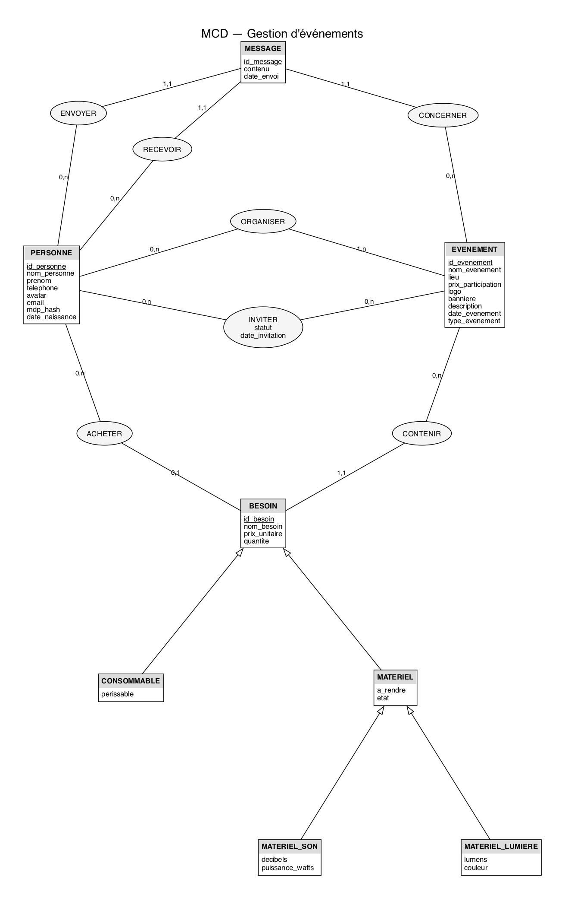

# Base de données (jalon 2)

SGBD : **SQLite** (un simple fichier `evenements.db`, rien à installer).

| Fichier | Contenu |
|---|---|
| [`mcd.png`](mcd.png) | MCD (Merise). Source : [`mcd.dot`](mcd.dot) |
| MLD | Ci-dessous ; détail et justification dans [`doc/cahier-des-charges.md`](../doc/cahier-des-charges.md), section 8 |
| [`schema.sql`](schema.sql) | Tables, clés, contraintes `CHECK`, index |
| [`donnees_test.sql`](donnees_test.sql) | Données de test (mots de passe déjà hachés en bcrypt : `motdepasse`) |
| [`optimisation.md`](optimisation.md) | 3 index justifiés par un `EXPLAIN QUERY PLAN` avant / après |
| [`db.properties.example`](db.properties.example) | Modèle de configuration de la connexion |

Code Java associé : `ConnexionBD`, `InitBase` (`serveur.bdd`), les DAO (`serveur.dao`), la transaction
(`serveur.service.Transaction`) et `serveur.MainTestBDD`.

## MCD



Conventions Merise : chaque attribut porte un nom unique dans tout le MCD (`id_personne`, `nom_evenement`…),
et les données calculées (coût, budget, âge, participants) n'y figurent pas.

## MLD

Clé primaire soulignée, clé étrangère précédée de `#`. Dans les tables, le nom de la table sert de préfixe :
`id_personne` du MCD devient `personne.id`, `nom_evenement` devient `evenement.nom`, `prix_unitaire` devient `besoin.prix`.

- **personne** (<u>id</u>, nom, prenom, telephone, avatar, email, mdp_hash, date_naissance)
- **evenement** (<u>id</u>, nom, lieu, prix, logo, banniere, description, date_evenement, type)
- **organisateur** (<u>#id_evenement, #id_personne</u>)
- **invitation** (<u>id</u>, #id_evenement, #id_personne, statut, date_invitation) — UNIQUE (id_evenement, id_personne). Issue de l'association INVITER du MCD : on lui ajoute un `id` technique pour que le code Java la désigne simplement, le couple (événement, personne) reste unique.
- **besoin** (<u>id</u>, #id_evenement, #id_acheteur, type, nom, prix, quantite, perissable, a_rendre, etat, decibels, puissance_watts, lumens, couleur)
- **message** (<u>id</u>, #id_evenement, #id_envoyeur, #id_receveur, contenu, date_envoi)

Héritage : dans le MCD, chaque sous-type de BESOIN (CONSOMMABLE, MATERIEL → MATERIEL_SON, MATERIEL_LUMIERE) n'a que ses propres attributs.
Le MLD la ramène à une table unique `besoin` avec une colonne `type` (justification : cahier des charges, 8.2) : les colonnes
d'un sous-type (ex. `puissance_watts`) restent `NULL` pour les autres, et des `CHECK` interdisent qu'un consommable en ait une.

## Recréer la base

Depuis la racine du projet (JDK 17 et Maven) :

```
cp bdd/db.properties.example src/main/resources/db.properties
mvn compile exec:java
```

`MainTestBDD` supprime `evenements.db`, exécute `schema.sql` puis `donnees_test.sql`, et rejoue le scénario de
validation du cahier des charges (authentification, invitations, besoins, transaction, suppression en cascade).
Il s'arrête sur la première vérification qui échoue.

Sans Java, avec le client `sqlite3` :

```
sqlite3 evenements.db < bdd/schema.sql
sqlite3 evenements.db < bdd/donnees_test.sql
```
