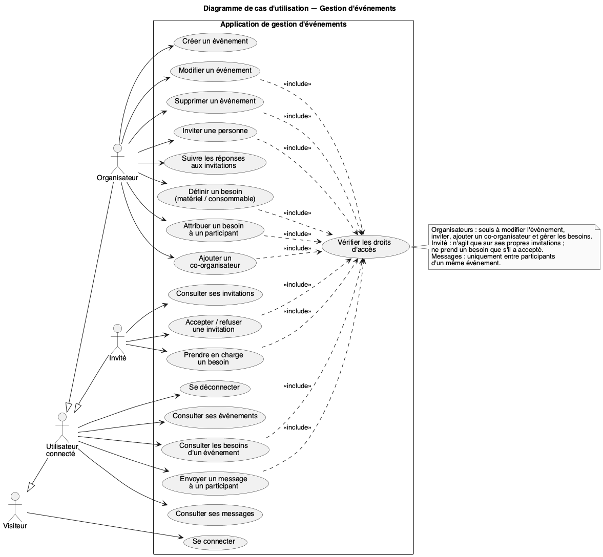
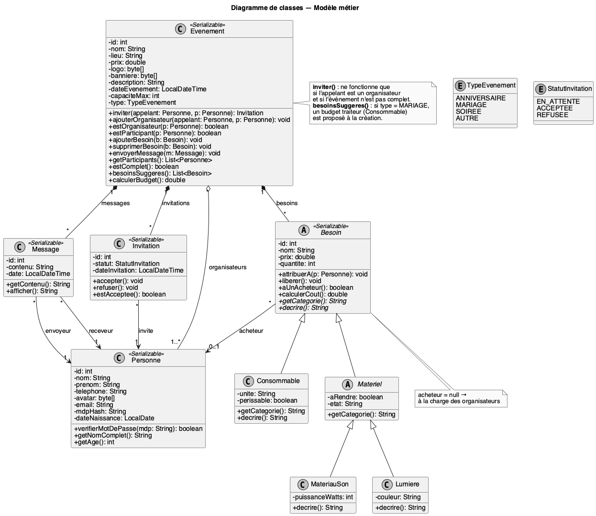
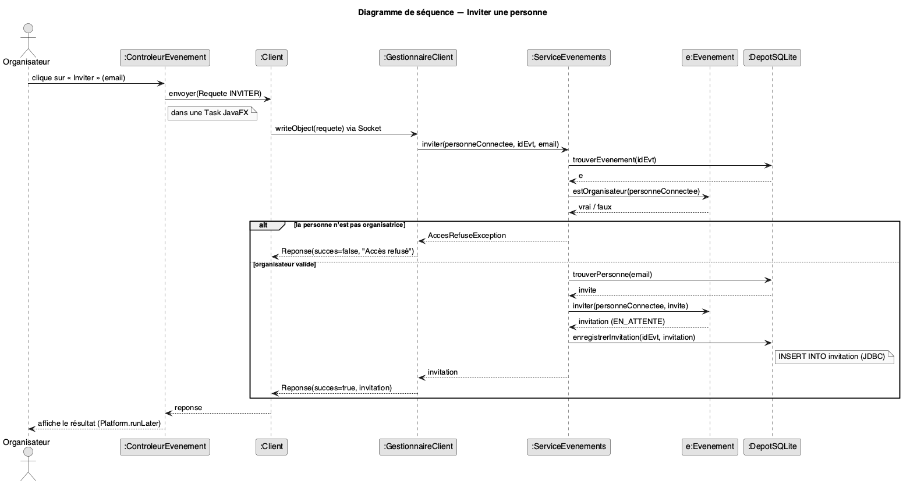

# Cahier des charges — Application de gestion d'événements

**Module :** Programmation Orientée Objet (Java)
**Rendu :** Étape 1 — Sujet, cahier des charges, description, conception UML
**Formation :** 3A FISA Informatique — groupe G1
**Membres :** Vince BONIFACE, Théo MARTIN, Romain NOTTEAU, Lony MICHAUX

---

## 1. Choix du sujet

Nous avons choisi de développer une **application client/serveur de gestion d'événements** (anniversaires, mariages, soirées…).

Un organisateur crée un événement, invite des personnes et liste ce qu'il faut acheter ou apporter (boissons, enceinte, éclairage…). Chaque invité répond à son invitation, peut prendre en charge l'achat d'un besoin et échanger des messages avec les autres participants.

**Pourquoi ce sujet :**

- **Héritage et polymorphisme naturels :** plusieurs types de besoins (`Consommable`, `Materiel`, lui-même décliné en `MateriauSon` et `Lumiere`) partagent un comportement commun mais se décrivent différemment (`decrire()`, `getCategorie()`).
- **Encapsulation et règles métier :** une invitation change d'état (en attente → acceptée / refusée), un besoin n'est attribué qu'à un participant, seuls les organisateurs invitent ; ces règles sont protégées dans les classes.
- **Réseau :** plusieurs personnes consultent et modifient les mêmes données, ce qui justifie une architecture client/serveur avec Sockets Java.
- **Utile au quotidien :** le besoin est concret (« qui achète quoi, pour quel budget ? ») et facile à démontrer.

---

## 2. Description du projet

### 2.1 Contexte

Organiser un événement entre amis ou en famille passe souvent par des groupes de messagerie : les réponses se perdent, on ne sait pas qui vient, et deux personnes achètent la même chose pendant que personne ne pense aux gobelets. Ce projet s'inscrit dans le module de POO en Java : l'objectif pédagogique est de mettre en œuvre une conception objet solide (héritage, polymorphisme, encapsulation, exceptions) dans une application réseau simple.

### 2.2 Objectifs

1. Centraliser les informations d'un événement (nom, date, lieu, description, capacité, prix, visuels) en un seul endroit.
2. Savoir à tout moment qui est invité, qui a accepté et qui a refusé.
3. Répartir les achats entre participants pour éviter oublis et doublons, et connaître le budget total.
4. Permettre aux participants d'échanger des messages au sein de l'événement.
5. Garantir que chacun n'agit que sur ce qui le concerne (contrôle d'accès).

### 2.3 Utilisateurs cibles

| Rôle             | Description                                                                                                        |
| ---------------- | ------------------------------------------------------------------------------------------------------------------ |
| **Visiteur**     | Personne non connectée : peut uniquement se connecter.                                                             |
| **Organisateur** | Personne qui a créé l'événement ou qui a été ajoutée comme co-organisateur : administre, invite, gère les besoins. |
| **Invité**       | Personne ayant reçu une invitation : y répond et, si elle a accepté, peut prendre en charge un besoin.             |

Une même personne peut être organisatrice d'un événement et invitée à un autre : le rôle dépend de l'événement, pas du compte.

### 2.4 Attentes

- Une application **fonctionnelle et démontrable** : un serveur et au moins deux clients lancés en même temps sur la même machine ou le même réseau local.
- Un **code lisible et structuré en paquets** (`modele`, `reseau`, `serveur`, `client`) qui reflète la conception UML.
- Une conception assez propre pour **ajouter un type de besoin sans modifier le reste du code** (nouvelle sous-classe de `Besoin` ou de `Materiel`) et **un type d'événement en ajoutant une valeur à `TypeEvenement`**.

---

## 3. Contraintes du projet

### 3.1 Contrainte de temps : 18 heures

Le volume horaire imparti (18 heures cumulées) délimite strictement le périmètre. L'accent est mis sur la solidité de la conception POO, l'héritage, la gestion réseau de base et l'encapsulation. Les fonctionnalités secondaires sont listées en section 5 (hors périmètre).

### 3.2 Contraintes techniques

| Élément            | Choix retenu                                            | Justification                                                                              |
| ------------------ | ------------------------------------------------------- | ------------------------------------------------------------------------------------------ |
| Langage            | Java 17                                                 | Imposé par le module ; `record`, `switch` modernes disponibles.                            |
| Build              | Maven (`pom.xml`)                                       | Compilation et dépendances identiques sur toutes les machines du groupe.                   |
| Bibliothèques      | `sqlite-jdbc`, `jBCrypt`, JavaFX (`org.openjfx`)        | Les seules dépendances du projet ; SQLite et bcrypt sont demandés par l'enseignant.        |
| Réseau             | Sockets TCP (`ServerSocket` / `Socket`) + flux d'objets | Plus simple qu'une API REST et directement lié au cours. Un thread par client connecté.    |
| Échanges           | Objets `Requete` / `Reponse` sérialisés                 | Protocole typé, pas de parsing de texte à écrire.                                          |
| Persistance        | Base SQLite accédée en JDBC (`sqlite-jdbc`)             | Données conservées entre deux lancements, dans un seul fichier, sans serveur à installer.  |
| Interface          | JavaFX (vues FXML + contrôleurs)                        | Interface graphique claire ; la séparation vue / contrôleur reste lisible en POO.          |
| Mots de passe      | Hachés avec bcrypt (`jBCrypt`)                          | Jamais stockés en clair ; bcrypt intègre un sel et un coût réglable contre la force brute. |
| Images             | Logo, bannière et avatar stockés en `byte[]` (BLOB)     | Sérialisables pour le réseau et stockables directement dans SQLite.                        |
| Dates              | `LocalDate` / `LocalDateTime` (`java.time`)             | API moderne et immuable, plus sûre que `java.util.Date`.                                   |
| Gestion de version | Git, un dépôt partagé                                   | Travail en groupe et historique des contributions.                                         |

---

## 4. Périmètre fonctionnel (développé dans les 18 h)

Priorités : **P1** = indispensable à la démonstration, **P2** = prévu, réalisé si le planning le permet.

### 4.1 Authentification

| ID  | Exigence                                                                                                           | Priorité |
| --- | ------------------------------------------------------------------------------------------------------------------ | -------- |
| F1  | La personne se connecte avec son e-mail et son mot de passe.                                                       | P1       |
| F2  | En cas d'échec, un message d'erreur est renvoyé sans préciser si c'est l'e-mail ou le mot de passe qui est faux.  | P1       |
| F3  | La personne peut se déconnecter.                                                                                   | P1       |
| F4  | Les comptes de test sont insérés dans la base SQLite au premier démarrage du serveur ; pas d'inscription en ligne. | P1       |

### 4.2 Gestion des événements

| ID  | Exigence                                                                                                                                                                                    | Priorité |
| --- | ------------------------------------------------------------------------------------------------------------------------------------------------------------------------------------------- | -------- |
| F5  | Une personne connectée crée un événement d'un type donné (anniversaire, mariage, soirée, autre) avec nom, description, date, lieu, capacité maximale et prix. Elle en devient organisatrice. | P1       |
| F6  | La personne voit la liste des événements qu'elle organise et de ceux auxquels elle est invitée.                                                                                             | P1       |
| F7  | Un organisateur modifie les informations de l'événement.                                                                                                                                    | P2       |
| F8  | Un organisateur supprime l'événement (invitations, besoins et messages associés sont supprimés).                                                                                            | P2       |
| F9  | À la création, l'application propose des besoins selon le type (`besoinsSuggeres()`) : pour un mariage, un budget traiteur (`Consommable`).                                                | P2       |
| F10 | Un organisateur ajoute un co-organisateur parmi les personnes existantes.                                                                                                                   | P2       |
| F11 | Un organisateur ajoute un logo et une bannière à l'événement ; chaque personne peut avoir un avatar.                                                                                        | P2       |

### 4.3 Invitations

| ID  | Exigence                                                                                                                     | Priorité |
| --- | ---------------------------------------------------------------------------------------------------------------------------- | -------- |
| F12 | Un organisateur invite une personne existante (par son e-mail). L'invitation est créée avec le statut `EN_ATTENTE`.          | P1       |
| F13 | Seul un organisateur de l'événement peut y inviter quelqu'un (sinon `AccesRefuseException`).                                 | P1       |
| F14 | Une même personne ne peut pas être invitée deux fois au même événement.                                                      | P1       |
| F15 | L'invité consulte ses invitations et les accepte ou les refuse. Il peut changer d'avis tant que l'événement n'est pas passé. | P1       |
| F16 | Une invitation ne peut plus être acceptée si l'événement a atteint sa capacité maximale (`estComplet()`).                    | P2       |
| F17 | Les organisateurs voient l'état de chaque invitation (en attente, acceptée, refusée).                                        | P1       |

### 4.4 Besoins et budget (héritage / polymorphisme)

| ID  | Exigence                                                                                                                                                                                                                  | Priorité |
| --- | ------------------------------------------------------------------------------------------------------------------------------------------------------------------------------------------------------------------------- | -------- |
| F18 | Un organisateur ajoute un besoin (nom, prix unitaire, quantité) : **consommable** (unité, périssable ou non) ou **matériel** (à rendre ou non, état), décliné en **matériel son** (puissance) ou **lumière** (couleur). | P1       |
| F19 | Chaque besoin s'affiche via sa propre méthode `decrire()` (ex. « 6 bouteilles de jus — consommable » / « 1 enceinte 200 W — matériel à rendre »).                                                                       | P1       |
| F20 | Un organisateur attribue l'achat d'un besoin à un participant.                                                                                                                                                            | P1       |
| F21 | Un invité ayant **accepté** l'invitation peut prendre en charge lui-même un besoin sans acheteur.                                                                                                                         | P1       |
| F22 | Un besoin n'est attribué qu'à un participant (organisateur ou invité ayant accepté). Si un invité refuse après coup, ses besoins sont libérés (`liberer()`).                                                               | P2       |
| F23 | Un besoin sans acheteur reste à la charge des organisateurs. Les participants voient qui achète quoi.                                                                                                                    | P1       |
| F24 | L'application calcule le coût de chaque besoin (`calculerCout()` = prix × quantité) et le budget total de l'événement (`calculerBudget()`).                                                                               | P1       |

### 4.5 Messages

| ID  | Exigence                                                                          | Priorité |
| --- | --------------------------------------------------------------------------------- | -------- |
| F25 | Un participant envoie un message texte à un autre participant du même événement.  | P2       |
| F26 | Chaque personne consulte les messages qu'elle a envoyés et reçus, triés par date. | P2       |

### 4.6 Communication réseau

| ID  | Exigence                                                                                                                           | Priorité |
| --- | ---------------------------------------------------------------------------------------------------------------------------------- | -------- |
| F27 | Le serveur écoute sur un port configurable et accepte plusieurs clients simultanés (un thread `GestionnaireClient` par connexion). | P1       |
| F28 | Chaque action du client est une `Requete` (type + paramètres) ; le serveur renvoie une `Reponse` (succès, message, données).       | P1       |
| F29 | Les accès concurrents aux données partagées sont protégés (`synchronized` sur le service).                                         | P1       |
| F30 | Les données à jour sont obtenues par rafraîchissement manuel (bouton « Actualiser » de l'interface).                               | P1       |

### 4.7 Persistance

| ID  | Exigence                                                                                                                                         | Priorité |
| --- | ------------------------------------------------------------------------------------------------------------------------------------------------ | -------- |
| F31 | Les données sont enregistrées dans une base SQLite via JDBC (tables `personne`, `evenement`, `organisateur`, `invitation`, `besoin`, `message`). | P1       |
| F32 | Chaque modification est écrite immédiatement dans la base ; au redémarrage du serveur, toutes les données sont retrouvées.                       | P1       |
| F33 | Les mots de passe sont stockés sous forme de hachés bcrypt (`mdpHash`) ; la connexion les vérifie avec `BCrypt.checkpw` (`verifierMotDePasse()`). | P1       |

### 4.8 Règles métier récapitulatives

1. Seuls les organisateurs modifient, suppriment, invitent, ajoutent un co-organisateur et gèrent les besoins de l'événement.
2. Un invité n'agit que sur **ses** invitations.
3. Seuls les participants (organisateurs + invités ayant accepté) peuvent se voir attribuer un besoin ou échanger des messages dans l'événement.
4. Le nombre d'invités ayant accepté ne dépasse jamais `capaciteMax`.
5. Un événement a toujours au moins un organisateur.
6. Toute violation d'une règle lève une exception métier, transformée par le serveur en `Reponse` d'échec avec un message clair.

---

## 5. Hors périmètre (justifié par les 18 h)

| Fonctionnalité                              | Raison / alternative                                                                     |
| ------------------------------------------- | ---------------------------------------------------------------------------------------- |
| Discussions de groupe, pièces jointes       | Seuls les messages texte d'une personne à une autre sont prévus.                         |
| Temps réel (WebSockets, notifications push) | Remplacé par un rafraîchissement au clic, éventuellement un requêtage périodique simple. |
| Paiement en ligne                           | Le prix et le budget sont indicatifs ; aucun paiement n'est géré.                        |
| Inscription en ligne, mot de passe oublié   | Comptes de test insérés dans la base au premier démarrage.                               |
| Chiffrement des échanges (TLS)              | Démonstration sur réseau local uniquement.                                               |

---

## 6. Exigences non fonctionnelles

- **Robustesse :** une entrée invalide (date mal formée, e-mail inconnu, prix négatif) affiche un message d'erreur et ne fait jamais planter le client ni le serveur.
- **Réactivité :** côté client, les appels réseau s'exécutent hors du thread JavaFX (`Task`) pour que l'interface ne se fige jamais.
- **Sécurité :** chaque requête est vérifiée côté serveur ; le client n'est jamais considéré comme fiable.
- **Maintenabilité :** attributs `private`, accès par méthodes ; ajouter un type de besoin = ajouter une sous-classe.
- **Portabilité :** fonctionne sur Windows, macOS et Linux avec un JDK 17 ; Maven récupère la version de JavaFX adaptée au système.
- **Lisibilité :** noms de classes et méthodes en français, cohérents avec les diagrammes UML.

---

## 7. Architecture

L'application est découpée en quatre paquets :

| Paquet    | Rôle                                         | Classes principales                                                                                                                                       |
| --------- | -------------------------------------------- | --------------------------------------------------------------------------------------------------------------------------------------------------------- |
| `modele`  | Objets métier et leurs règles                | `Personne`, `Evenement`, `TypeEvenement`, `Invitation`, `StatutInvitation`, `Message`, `Besoin` (+ `Consommable`, `Materiel` → `MateriauSon`, `Lumiere`) |
| `reseau`  | Protocole partagé entre client et serveur    | `Requete`, `Reponse`, `TypeRequete`                                                                                                                       |
| `serveur` | Écoute réseau, contrôle d'accès, persistance | `Serveur`, `GestionnaireClient`, `ServiceEvenements`, `Depot` (interface), `DepotSQLite`, exceptions                                                      |
| `client`  | Connexion au serveur et interface JavaFX     | `Client`, `ApplicationClient`, `ControleurConnexion`, `ControleurEvenements`, `ControleurEvenement` (+ vues `.fxml`)                                      |

Notions POO mises en œuvre :

- **Héritage :** `Besoin` → `Consommable`, `Materiel` ; `Materiel` → `MateriauSon`, `Lumiere`.
- **Classes abstraites et polymorphisme :** `Besoin` et `Materiel` sont abstraites ; `decrire()` et `getCategorie()` sont redéfinies dans les sous-classes.
- **Interface :** `Depot`, implémentée par `DepotSQLite` (le service ne dépend que de l'interface : on pourrait changer de base sans le modifier).
- **Composition :** un `Evenement` possède ses `Invitation`, ses `Besoin` et ses `Message` (supprimés avec lui).
- **Agrégation :** un `Evenement` référence ses organisateurs (`Personne`), qui existent indépendamment de lui.
- **Énumérations :** `TypeEvenement`, `StatutInvitation`, `TypeRequete`.
- **Exceptions personnalisées :** `AccesRefuseException`, `AuthentificationException`.
- **Threads :** un `GestionnaireClient` (`Runnable`) par client connecté côté serveur ; une `Task` JavaFX par appel réseau côté client.

---

## 8. Conception UML

Les sources PlantUML (`.puml`) et les images sont dans le dossier `uml/`.

### 8.1 Diagramme de cas d'utilisation

Les actions sensibles incluent toutes le cas « Vérifier les droits d'accès », réalisé côté serveur par `ServiceEvenements`.

### 8.2 Diagramme de classes

Un `Evenement` est composé de ses invitations, de ses besoins et de ses messages, et agrège ses organisateurs. `Besoin` est abstraite et se spécialise en `Consommable` et `Materiel` (`MateriauSon`, `Lumiere`). Les classes échangées sur le réseau sont `Serializable`.

### 8.3 Diagramme de séquence — Inviter une personne

Ce diagramme montre le trajet complet d'une requête : de l'interface JavaFX jusqu'au serveur, la vérification des droits, l'écriture dans SQLite, puis la réponse renvoyée au client.

---

## 9. Planning prévisionnel (18 h)

| Séance | Durée | Contenu                                                                      | Livrable                            |
| ------ | ----- | ---------------------------------------------------------------------------- | ----------------------------------- |
| 1      | 3 h   | Sujet, cahier des charges, UML                                               | **Étape 1 (ce document)**           |
| 2      | 3 h   | Paquet `modele` (classes, héritage, règles métier) + schéma SQLite           | Modèle testé avec un `main` de test |
| 3      | 3 h   | `reseau` + `serveur` : sockets, threads, `DepotSQLite`, bcrypt               | Serveur qui authentifie et répond   |
| 4      | 3 h   | Paquet `client` : écrans JavaFX, toutes les requêtes P1                      | Démonstration à deux clients        |
| 5      | 3 h   | Fonctionnalités P2 (messages, co-organisateurs, images), gestion des erreurs | Version complète                    |
| 6      | 3 h   | Tests, corrections, README, préparation de la soutenance                     | Rendu final                         |

---

## 10. Critères de validation

Le projet est considéré comme réussi si le scénario suivant fonctionne avec un serveur et deux clients :

1. Alice se connecte et crée une soirée de 10 places.
2. Alice invite Bob ; Bob voit l'invitation et l'accepte.
3. Alice ajoute deux besoins : « 6 bouteilles de jus » (consommable, 2 € l'unité) et « 1 enceinte » (matériel son à rendre, 30 €).
4. Bob prend en charge l'enceinte ; Alice voit, après actualisation, que Bob l'achète et que le budget total est de 42 €.
5. Bob tente de modifier la soirée d'Alice : le serveur refuse avec « Accès refusé ».
6. Le serveur est redémarré : la soirée, l'invitation et les besoins sont toujours là (lus depuis la base SQLite).
