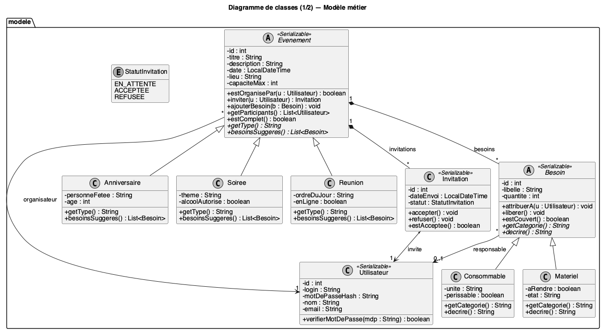
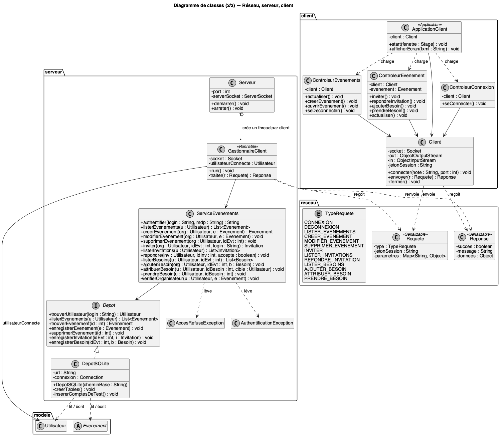

# Cahier des charges — Application de gestion d'événements

**Module :** Programmation Orientée Objet (Java)
**Rendu :** Étape 1 — Sujet, cahier des charges, description, conception UML
**Formation :** 3A FISA Informatique — groupe G1
**Membres :** Vince BONIFACE, Théo MARTIN, Romain NOTTEAU, Lony MICHAUX

---

## 1. Choix du sujet

Nous avons choisi de développer une **application client/serveur de gestion d'événements** (anniversaires, soirées, réunions).

Un organisateur crée un événement, invite des personnes et liste ce qu'il faut apporter (boissons, enceinte, chaises…). Chaque invité répond à son invitation et peut se proposer pour apporter un des éléments.

**Pourquoi ce sujet :**

- **Héritage et polymorphisme naturels :** plusieurs types d'événements (`Anniversaire`, `Soiree`, `Reunion`) et plusieurs types de besoins (`Consommable`, `Materiel`) partagent un comportement commun mais se décrivent différemment.
- **Encapsulation et règles métier :** une invitation change d'état (en attente → acceptée / refusée), un besoin n'est attribué qu'à un participant ; ces règles sont protégées dans les classes.
- **Réseau :** plusieurs utilisateurs consultent et modifient les mêmes données, ce qui justifie une architecture client/serveur avec Sockets Java.
- **Utile au quotidien :** le besoin est concret (« qui apporte quoi ? ») et facile à démontrer.

---

## 2. Description du projet

### 2.1 Contexte

Organiser un événement entre amis ou entre collègues passe souvent par des groupes de messagerie : les réponses se perdent, on ne sait pas qui vient, et deux personnes apportent la même chose pendant que personne ne pense aux gobelets. Ce projet s'inscrit dans le module de POO en Java : l'objectif pédagogique est de mettre en œuvre une conception objet solide (héritage, polymorphisme, encapsulation, exceptions) dans une application réseau simple.

### 2.2 Objectifs

1. Centraliser les informations d'un événement (date, lieu, description, capacité) en un seul endroit.
2. Savoir à tout moment qui est invité, qui a accepté et qui a refusé.
3. Répartir les besoins logistiques entre participants pour éviter oublis et doublons.
4. Garantir que chacun n'agit que sur ce qui le concerne (contrôle d'accès).

### 2.3 Utilisateurs cibles

| Rôle             | Description                                                                              |
| ---------------- | ---------------------------------------------------------------------------------------- |
| **Visiteur**     | Personne non connectée : peut uniquement se connecter.                                   |
| **Organisateur** | Utilisateur qui a créé un événement : il l'administre, invite et gère les besoins.       |
| **Invité**       | Utilisateur ayant reçu une invitation : il y répond et peut prendre en charge un besoin. |

Un même compte peut être organisateur d'un événement et invité à un autre : le rôle dépend de l'événement, pas du compte.

### 2.4 Attentes

- Une application **fonctionnelle et démontrable** : un serveur et au moins deux clients lancés en même temps sur la même machine ou le même réseau local.
- Un **code lisible et structuré en paquets** (`modele`, `reseau`, `serveur`, `client`) qui reflète la conception UML.
- Une conception assez propre pour **ajouter un type d'événement ou de besoin sans modifier le reste du code** (nouvelle sous-classe uniquement).

---

## 3. Contraintes du projet

### 3.1 Contrainte de temps : 18 heures

Le volume horaire imparti (18 heures cumulées) délimite strictement le périmètre. L'accent est mis sur la solidité de la conception POO, l'héritage, la gestion réseau de base et l'encapsulation. Les fonctionnalités secondaires sont listées en section 5 (hors périmètre).

### 3.2 Contraintes techniques

| Élément            | Choix retenu                                            | Justification                                                                           |
| ------------------ | ------------------------------------------------------- | --------------------------------------------------------------------------------------- |
| Langage            | Java 17                                                 | Imposé par le module ; `record`, `switch` modernes disponibles.                         |
| Build              | Maven (`pom.xml`)                                       | Compilation et dépendances identiques sur toutes les machines du groupe.               |
| Bibliothèques      | `sqlite-jdbc`, `jBCrypt`, JavaFX (`org.openjfx`)        | Les seules dépendances du projet ; SQLite et bcrypt sont demandés par l'enseignant.     |
| Réseau             | Sockets TCP (`ServerSocket` / `Socket`) + flux d'objets | Plus simple qu'une API REST et directement lié au cours. Un thread par client connecté. |
| Échanges           | Objets `Requete` / `Reponse` sérialisés                 | Protocole typé, pas de parsing de texte à écrire.                                       |
| Persistance        | Base SQLite accédée en JDBC (`sqlite-jdbc`)             | Données conservées entre deux lancements, dans un seul fichier, sans serveur à installer. |
| Interface          | JavaFX (vues FXML + contrôleurs)                        | Interface graphique claire ; la séparation vue / contrôleur reste lisible en POO.       |
| Mots de passe      | Hachés avec bcrypt (`jBCrypt`)                          | Jamais stockés en clair ; bcrypt intègre un sel et un coût réglable contre la force brute. |
| Gestion de version | Git, un dépôt partagé                                   | Travail en groupe et historique des contributions.                                      |

---

## 4. Périmètre fonctionnel (développé dans les 18 h)

Priorités : **P1** = indispensable à la démonstration, **P2** = prévu, réalisé si le planning le permet.

### 4.1 Authentification

| ID  | Exigence                                                                                                              | Priorité |
| --- | --------------------------------------------------------------------------------------------------------------------- | -------- |
| F1  | L'utilisateur se connecte avec un identifiant et un mot de passe.                                                     | P1       |
| F2  | En cas d'échec, un message d'erreur est renvoyé sans préciser si c'est l'identifiant ou le mot de passe qui est faux. | P1       |
| F3  | L'utilisateur peut se déconnecter.                                                                                    | P1       |
| F4  | Les comptes de test sont insérés dans la base SQLite au premier démarrage du serveur ; pas d'inscription en ligne.     | P1       |

### 4.2 Gestion des événements

| ID  | Exigence                                                                                                                                                                          | Priorité |
| --- | --------------------------------------------------------------------------------------------------------------------------------------------------------------------------------- | -------- |
| F5  | Un utilisateur connecté crée un événement d'un type donné (anniversaire, soirée, réunion) avec titre, description, date, lieu et capacité maximale. Il en devient l'organisateur. | P1       |
| F6  | L'utilisateur voit la liste des événements qu'il organise et de ceux auxquels il est invité.                                                                                      | P1       |
| F7  | L'organisateur modifie les informations de son événement.                                                                                                                         | P2       |
| F8  | L'organisateur supprime son événement (les invitations et besoins associés sont supprimés).                                                                                       | P2       |
| F9  | À la création, l'application propose des besoins par défaut selon le type d'événement (polymorphisme : `besoinsSuggeres()`).                                                      | P2       |

### 4.3 Invitations

| ID  | Exigence                                                                                                                     | Priorité |
| --- | ---------------------------------------------------------------------------------------------------------------------------- | -------- |
| F10 | L'organisateur invite un utilisateur existant (par son identifiant). L'invitation est créée avec le statut `EN_ATTENTE`.     | P1       |
| F11 | Seul l'organisateur d'un événement peut y inviter quelqu'un (sinon `AccesRefuseException`).                                  | P1       |
| F12 | Un même utilisateur ne peut pas être invité deux fois au même événement.                                                     | P1       |
| F13 | L'invité consulte ses invitations et les accepte ou les refuse. Il peut changer d'avis tant que l'événement n'est pas passé. | P1       |
| F14 | Une invitation ne peut plus être acceptée si l'événement a atteint sa capacité maximale.                                     | P2       |
| F15 | L'organisateur voit l'état de chaque invitation (en attente, acceptée, refusée).                                             | P1       |

### 4.4 Besoins (héritage / polymorphisme)

| ID  | Exigence                                                                                                                                              | Priorité |
| --- | ----------------------------------------------------------------------------------------------------------------------------------------------------- | -------- |
| F16 | L'organisateur ajoute un besoin à son événement : **consommable** (unité, périssable ou non) ou **matériel** (à rendre ou non, état).                 | P1       |
| F17 | Chaque besoin s'affiche via sa propre méthode `decrire()` (ex. « 6 bouteilles de jus — consommable » / « 1 enceinte — matériel à rendre »).           | P1       |
| F18 | L'organisateur attribue un besoin à un participant.                                                                                                   | P1       |
| F19 | Un invité ayant **accepté** l'invitation peut prendre en charge lui-même un besoin non attribué.                                                      | P1       |
| F20 | Un besoin ne peut être attribué qu'à un participant (organisateur ou invité ayant accepté). Si un invité refuse après coup, ses besoins sont libérés. | P2       |
| F21 | Les participants consultent la liste des besoins et voient lesquels sont couverts.                                                                    | P1       |

### 4.5 Communication réseau

| ID  | Exigence                                                                                                                           | Priorité |
| --- | ---------------------------------------------------------------------------------------------------------------------------------- | -------- |
| F22 | Le serveur écoute sur un port configurable et accepte plusieurs clients simultanés (un thread `GestionnaireClient` par connexion). | P1       |
| F23 | Chaque action du client est une `Requete` (type + paramètres) ; le serveur renvoie une `Reponse` (succès, message, données).       | P1       |
| F24 | Les accès concurrents aux données partagées sont protégés (`synchronized` sur le service).                                         | P1       |
| F25 | Les données à jour sont obtenues par rafraîchissement manuel (bouton « Actualiser » de l'interface).                               | P1       |

### 4.6 Persistance

| ID  | Exigence                                                                                                        | Priorité |
| --- | --------------------------------------------------------------------------------------------------------------- | -------- |
| F26 | Les données sont enregistrées dans une base SQLite (tables `utilisateur`, `evenement`, `invitation`, `besoin`), via JDBC. | P1       |
| F27 | Chaque modification est écrite immédiatement dans la base ; au redémarrage du serveur, toutes les données sont retrouvées. | P1       |
| F28 | Les mots de passe sont stockés sous forme de hachés bcrypt ; la connexion compare le mot de passe saisi avec `BCrypt.checkpw`. | P1       |

### 4.7 Règles métier récapitulatives

1. Seul l'organisateur modifie, supprime, invite et ajoute des besoins sur son événement.
2. Un invité n'agit que sur **ses** invitations.
3. Seuls les participants (organisateur + invités ayant accepté) peuvent se voir attribuer un besoin.
4. Le nombre d'invités ayant accepté ne dépasse jamais `capaciteMax`.
5. Toute violation d'une règle lève une exception métier, transformée par le serveur en `Reponse` d'échec avec un message clair.

---

## 5. Hors périmètre (justifié par les 18 h)

| Fonctionnalité                              | Raison / alternative                                                                        |
| ------------------------------------------- | ------------------------------------------------------------------------------------------- |
| Annonces de l'organisateur aux invités      | Demande un système de messages et de notifications : secondaire par rapport au cœur métier. |
| Temps réel (WebSockets, notifications push) | Remplacé par un rafraîchissement au clic, éventuellement un requêtage périodique simple.    |
| Inscription en ligne, mot de passe oublié   | Comptes de test insérés dans la base au premier démarrage.                                  |
| Chiffrement des échanges (TLS)              | Démonstration sur réseau local uniquement.                                                  |

---

## 6. Exigences non fonctionnelles

- **Robustesse :** une entrée invalide (date mal formée, identifiant inconnu) affiche un message d'erreur et ne fait jamais planter le client ni le serveur.
- **Réactivité :** côté client, les appels réseau s'exécutent hors du thread JavaFX (`Task`) pour que l'interface ne se fige jamais.
- **Sécurité :** chaque requête est vérifiée côté serveur ; le client n'est jamais considéré comme fiable.
- **Maintenabilité :** attributs `private`, accès par méthodes ; ajouter un type d'événement ou de besoin = ajouter une sous-classe.
- **Portabilité :** fonctionne sur Windows, macOS et Linux avec un JDK 17 ; Maven récupère la version de JavaFX adaptée au système.
- **Lisibilité :** noms de classes et méthodes en français, cohérents avec les diagrammes UML.

---

## 7. Architecture

L'application est découpée en quatre paquets :

| Paquet    | Rôle                                         | Classes principales                                                                                                                          |
| --------- | -------------------------------------------- | -------------------------------------------------------------------------------------------------------------------------------------------- |
| `modele`  | Objets métier et leurs règles                | `Utilisateur`, `Evenement` (+ `Anniversaire`, `Soiree`, `Reunion`), `Invitation`, `StatutInvitation`, `Besoin` (+ `Consommable`, `Materiel`) |
| `reseau`  | Protocole partagé entre client et serveur    | `Requete`, `Reponse`, `TypeRequete`                                                                                                          |
| `serveur` | Écoute réseau, contrôle d'accès, persistance | `Serveur`, `GestionnaireClient`, `ServiceEvenements`, `Depot`, `DepotSQLite`, exceptions                                                    |
| `client`  | Connexion au serveur et interface JavaFX     | `Client`, `ApplicationClient`, `ControleurConnexion`, `ControleurEvenements`, `ControleurEvenement` (+ vues `.fxml`)                         |

Notions POO mises en œuvre :

- **Héritage :** `Evenement` → `Anniversaire`, `Soiree`, `Reunion` ; `Besoin` → `Consommable`, `Materiel`.
- **Classes abstraites et polymorphisme :** `getType()`, `besoinsSuggeres()`, `getCategorie()`, `decrire()`.
- **Interface :** `Depot`, implémentée par `DepotSQLite` (le service ne dépend que de l'interface : on pourrait changer de base sans le modifier).
- **Composition :** un `Evenement` possède ses `Invitation` et ses `Besoin` (supprimés avec lui).
- **Énumérations :** `StatutInvitation`, `TypeRequete`.
- **Exceptions personnalisées :** `AccesRefuseException`, `AuthentificationException`.
- **Threads :** un `GestionnaireClient` (`Runnable`) par client connecté côté serveur ; une `Task` JavaFX par appel réseau côté client.

---

## 8. Conception UML

Les sources PlantUML (`.puml`) et les images sont dans le dossier `uml/`.

### 8.1 Diagramme de cas d'utilisation

Les actions sensibles incluent toutes le cas « Vérifier les droits d'accès », réalisé côté serveur par `ServiceEvenements`.

### 8.2 Diagramme de classes

Le modèle métier concentre l'héritage (`Evenement`, `Besoin`) et les règles d'encapsulation (changement de statut d'une invitation, attribution d'un besoin).

Le serveur crée un `GestionnaireClient` par connexion ; toutes les vérifications de droits passent par `ServiceEvenements`.

### 8.3 Diagramme de séquence — Inviter un utilisateur

Ce diagramme montre le trajet complet d'une requête : de l'interface JavaFX jusqu'au serveur, la vérification des droits, puis la réponse renvoyée au client.

---

## 9. Planning prévisionnel (18 h)

| Séance | Durée | Contenu                                                             | Livrable                            |
| ------ | ----- | ------------------------------------------------------------------- | ----------------------------------- |
| 1      | 3 h   | Sujet, cahier des charges, UML                                      | **Étape 1 (ce document)**           |
| 2      | 3 h   | Paquet `modele` (classes, héritage, règles métier) + schéma SQLite  | Modèle testé avec un `main` de test |
| 3      | 3 h   | `reseau` + `serveur` : sockets, threads, `DepotSQLite`, bcrypt      | Serveur qui authentifie et répond   |
| 4      | 3 h   | Paquet `client` : écrans JavaFX, toutes les requêtes P1             | Démonstration à deux clients        |
| 5      | 3 h   | Fonctionnalités P2, gestion des erreurs, finitions de l'interface   | Version complète                    |
| 6      | 3 h   | Tests, corrections, README, préparation de la soutenance            | Rendu final                         |

---

## 10. Critères de validation

Le projet est considéré comme réussi si le scénario suivant fonctionne avec un serveur et deux clients :

1. Alice se connecte et crée une soirée de 10 places.
2. Alice invite Bob ; Bob voit l'invitation et l'accepte.
3. Alice ajoute deux besoins : « 6 bouteilles de jus » (consommable) et « 1 enceinte » (matériel à rendre).
4. Bob prend en charge l'enceinte ; Alice voit, après actualisation, que l'enceinte est couverte.
5. Bob tente de modifier la soirée d'Alice : le serveur refuse avec « Accès refusé ».
6. Le serveur est redémarré : la soirée, l'invitation et les besoins sont toujours là (lus depuis la base SQLite).
