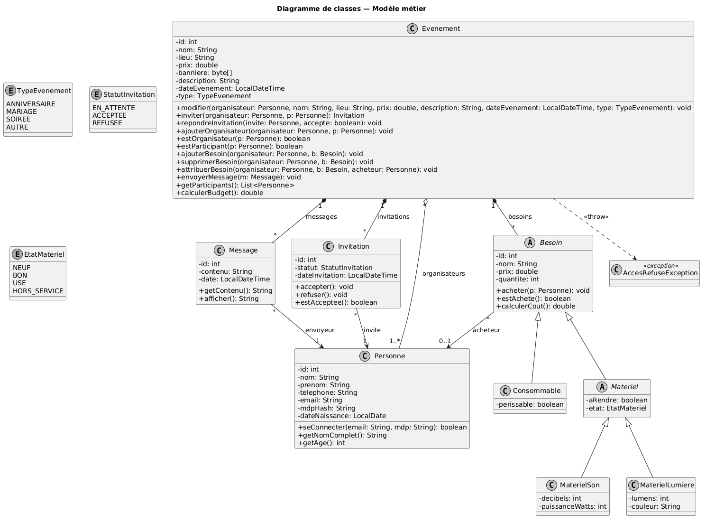
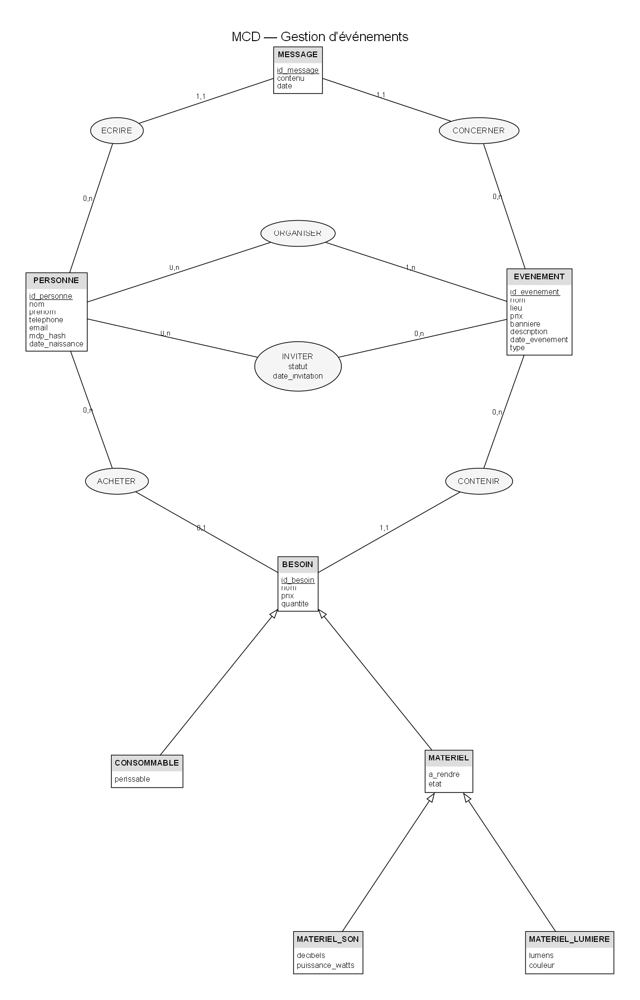

# Cahier des charges — Gestion d'événements

**Module :** Programmation Orientée Objet (Java) — 3A FISA Informatique, groupe G1
**Membres :** Vince BONIFACE, Théo MARTIN, Romain NOTTEAU, Lony MICHAUX

---

## 1. Présentation

Application client/serveur pour organiser un événement entre amis ou en famille (anniversaire, mariage, soirée…).

Un organisateur crée un événement, invite des personnes et liste ce qu'il faut acheter ou apporter (boissons, enceinte, éclairage…). Les invités acceptent ou refusent, prennent en charge des achats, et l'application calcule le budget total.

**Objectif :** savoir qui vient, qui achète quoi et combien ça coûte, au même endroit.

---

## 2. Utilisateurs

Le rôle d'une personne dépend de l'événement : on peut organiser un événement et être invité à un autre.

| Rôle | Ce qu'il peut faire |
|---|---|
| **Utilisateur** | Se connecter, créer un événement (il en devient organisateur). |
| **Invité** | Accepter ou refuser son invitation. |
| **Participant** | Organisateur, ou invité qui a accepté. Voit l'événement, ses besoins et le budget, prend en charge un besoin. |
| **Organisateur** | Gère l'événement : le modifie, invite, ajoute un co-organisateur, gère les besoins. |

---

## 3. Fonctionnalités

- Se connecter avec son e-mail et son mot de passe.
- Créer un événement : nom, type (anniversaire, mariage, soirée, autre), date, lieu, prix, description, bannière.
- Modifier un événement.
- Voir la liste de ses événements (organisés et invités).
- Ajouter un co-organisateur.
- Inviter une personne à un événement.
- Accepter ou refuser une invitation.
- Ajouter ou supprimer un besoin : consommable, matériel son ou matériel lumière.
- Prendre en charge un besoin, ou l'attribuer à un participant (organisateur).
- Afficher le coût de chaque besoin et le budget total de l'événement.
- Envoyer et lire des messages sur l'événement (entre participants).

### Hors périmètre

- Supprimer un événement.
- Créer un compte : les comptes de test sont déjà en base.

---

## 4. Règles de gestion

1. Seul un organisateur peut modifier l'événement, inviter, ajouter un co-organisateur et gérer les besoins.
2. Une personne ne peut pas être invitée deux fois au même événement.
3. Seul un participant peut prendre en charge un besoin ou envoyer un message.
4. Un événement a toujours au moins un organisateur.
5. Coût d'un besoin = prix × quantité ; budget = somme des coûts des besoins.

Si une règle de droits n'est pas respectée, l'action est refusée (`AccesRefuseException`).

---

## 5. Conception

### Diagramme de classes

Un `Evenement` contient ses invitations, ses besoins et ses messages, et a un ou plusieurs organisateurs. `Besoin` est abstraite : elle se décline en `Consommable` et `Materiel` (`MaterielSon`, `MaterielLumiere`).

### MCD

### MLD

Voir [`bdd/mld.md`](bdd/mld.md).

---

## 6. Scénario de démonstration

Avec un serveur et deux clients lancés :

1. Alice se connecte et crée une soirée.
2. Alice invite Bob ; Bob se connecte, voit l'invitation et l'accepte.
3. Alice ajoute deux besoins : 6 bouteilles de jus (consommable, 2 € l'unité) et 1 enceinte (matériel son, 30 €).
4. Bob prend en charge l'enceinte ; Alice voit que Bob l'achète et que le budget total est de 42 €.
5. Bob envoie un message sur la soirée ; Alice le lit.
6. Bob essaie d'inviter quelqu'un : l'action est refusée, car il n'est pas organisateur.

---

## 7. Répartition du travail

Le suivi se fait sur GitHub : un jalon par partie, une issue par tâche.

| Jalon | Issues | Responsable(s) |
|---|---|---|
| Documentation | #7 Diagrammes, #8 Cahier des charges | Romain NOTTEAU, Lony MICHAUX |
| Modèle métier | #1 Classes du modèle, #9 Règles de gestion et droits d'accès | Vince BONIFACE, Théo MARTIN, Romain NOTTEAU |
| Base de données | #2 Schéma SQL, #3 DAO, #10 Données de test | Romain NOTTEAU |
| Réseau et serveur | #11 Serveur sockets multi-clients, #12 Protocole requête / réponse, #13 Authentification | Toute l'équipe |
| Client JavaFX | #4 Connexion, #5 Accueil, #6 Page événement, #14 Invitations, #15 Besoins et budget, #16 Messages | Théo MARTIN |
